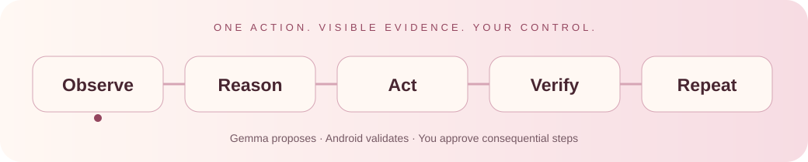

# HandsFree AI

### A little help. Your way.

**Tell your phone what you need. Stay in control of what happens next.**

Built by **Team MERCI** for **Hacktoberfest Hack Day Bengaluru 2026**

[What it does](#what-it-does) · [How it works](#how-it-works) · [Get started](#get-started) · [Try a conversation](#try-a-conversation) · [Current status](#current-status)

---

## What it does

HandsFree is an Android accessibility assistant for people who want help navigating everyday apps. It reads accessible app controls, asks a local Gemma model for the next action, checks that action against deterministic rules, and observes the result.

<table>
<tr>
<td width="50%">

### Speak once to begin

Start a conversation, then speak requests and replies across apps. Approval questions are read aloud. Text input remains available.

</td>
<td width="50%">

### Choose what you actually want

A request for lunch starts a conversation about your preferences. The assistant does not choose a dish, budget or restaurant for you.

</td>
</tr>
<tr>
<td>

### Work with real apps

Find installed apps, open them, read accessible controls and propose clicks, text entry, scrolling and navigation.

</td>
<td>

### Keep the final say

Review consequential actions. Stop whenever you need. Passwords, authentication and payment remain under your control.

</td>
</tr>
</table>

> **Development MVP:** real Android and local-model integration are implemented. Full third-party food-to-cart and hands-free voice acceptance are still being validated. A successful build is not a claim that every app workflow works.

## How it works

The animation illustrates the control loop; it is not a live task indicator.

~~~mermaid
flowchart LR
    U["You Voice or text"] --> A["Android app Compose conversation UI"]
    A --> C["Task controller Goal · choices · consent"]
    C --> O["Observe Sanitized accessibility tree"]
    O --> B["Local FastAPI bridge"]
    B --> G["Ollama Gemma 4 E2B"]
    G --> P["One proposed action"]
    P --> S{"Android safety checks"}
    S -->|"Needs approval"| U
    S -->|"Allowed and current"| E["Accessibility actions or Android Intents"]
    E --> V["Observe and verify"]
    V --> C
    S -->|"Unsafe or stale"| R["Reject · retry · ask"]
    classDef blush fill:#f7dce3,stroke:#94465f,color:#482631;
    classDef cream fill:#fff8f3,stroke:#d6a5b5,color:#482631;
    class U,A,C,V blush;
    class O,B,G,P,S,E,R cream;
~~~

**Gemma proposes. Android validates.** Model output cannot execute code, shell commands or arbitrary device operations.

### Voice and device connectivity

~~~mermaid
sequenceDiagram
    actor User
    participant Phone as Android
    participant Bridge as FastAPI localhost:8000
    participant Speech as Configured speech service
    participant Model as Ollama localhost:11434
    User->>Phone: Start conversation once
    Phone->>Phone: Start permitted microphone foreground service
    loop While the conversation is active
        User->>Phone: Request, answer or approval
        Phone->>Bridge: Bounded speech over ADB reverse
        Bridge->>Speech: Transcribe speech
        Speech-->>Phone: Transcript through bridge
        Phone->>Bridge: Goal and sanitized screen
        Bridge->>Model: Propose one action
        Model-->>Phone: Structured action through bridge
        Phone->>Phone: Validate, request approval, act, verify
    end
    User->>Phone: Stop conversation
    Phone->>Phone: Cancel work and release microphone
~~~

Reasoning runs on the laptop. Speech recordings and spoken-response text use the configured speech service through the backend. Credentials stay on the laptop. Silence is discarded locally. Listening pauses during the assistant's own speech.

## Get started

### 1. Prepare the laptop

| Requirement | Development setup |
|---|---|
| OS | Windows |
| Android tools | Android Studio, SDK 37, platform tools |
| Java | Android Studio JBR; this project builds with JBR 25 |
| Android build | Gradle 9.6.0 / AGP 9.4.1 |
| Backend | Python 3.12+ |
| Local reasoning | Ollama with **gemma4:e2b** |
| Device | USB-connected Android phone with debugging enabled |

Verify the model is installed:

~~~powershell
ollama list
~~~

Create the Python environment and install dependencies:

~~~powershell
python -m venv .venv
.\.venv\Scripts\python.exe -m pip install -r backend\requirements.txt
~~~

Create **.env.local** using **[.env.example](.env.example)** as the template. Configure the optional voice credentials there. Do not overwrite an existing credentials file.

Configuration priority: process environment → .env.local → .env.

### 2. Start the local backend

~~~powershell
.\.venv\Scripts\python.exe -m backend.run
~~~

| Service | Address |
|---|---|
| Android bridge | http://127.0.0.1:8000 |
| Health | http://127.0.0.1:8000/health |
| Model availability | http://127.0.0.1:8000/model/status |
| Ollama | http://127.0.0.1:11434 |

The bridge binds to loopback. Keep both services local.

### 3. Connect and install

Unlock the phone and approve Android's USB debugging prompt.

~~~powershell
$adbPath = "$env:LOCALAPPDATA\Android\Sdk\platform-tools\adb.exe"
& $adbPath devices -l

# Replace this with your own device ID if needed.
$deviceId = "2a7a1d50"
& $adbPath -s $deviceId reverse tcp:8000 tcp:8000

$env:JAVA_HOME = "C:\Program Files\Android\Android Studio\jbr"
.\gradlew.bat :app:assembleDebug --no-daemon
& $adbPath -s $deviceId install -r app\build\outputs\apk\debug\app-debug.apk
~~~

Repeat ADB reverse after reconnecting USB. Keep model inference and Gradle builds separate on laptops with limited memory.

### 4. Enable screen access

1. Open **HandsFree → Settings → Screen access settings → Open settings**.
2. Find **Downloaded apps / Installed services → HandsFree AI**.
3. Enable the service and approve Android's confirmation yourself.
4. Return to HandsFree and check **Screen access is on**.

If Android restricts the setting, follow its supported App info approval flow. See [Android's restricted-settings instructions](https://support.google.com/android/answer/12623953).

### 5. Start a conversation

Tap **Start conversation** and complete the initial audio disclosure/microphone permission.

Speak your goal. Questions and approvals can be answered aloud. Say **“approve”** or **“decline”** when asked to authorize an action.

| Say or tap | Result |
|---|---|
| **New task / Start over** | Cancel the task and clear context; the conversation stays available |
| **Home** | Return to HandsFree's home screen and clear the task |
| **Phone home** | Cancel the task and return to the Android launcher |
| **Stop conversation / Stop** | Cancel the task and end microphone access |
| **Send task** | Submit a typed instruction |
| **Your apps** | Search and open actual installed apps |

Initial Android permission prompts require touch. Private authentication and final payment also remain manual.

## Try a conversation

> “I want to order some snacks for 5 PM.”

The intended flow is:

1. Discover supported installed food apps.
2. Ask which app to use if several are available.
3. Ask what you want, your budget, dietary needs, quantity and timing.
4. Search real app information and ask you to choose an observed option.
5. Propose adding only the selected items and quantities.
6. Open the cart and read its actual items, quantities and labeled payable total.
7. Ask you to confirm the cart, announce the displayed amount and hand over payment.

**A requested time is a preference, not a scheduled order.** App availability, menus and accessible controls vary. Missing or ambiguous evidence prevents a verified-completion claim.

The item is supplied by the conversation. There is no fixed dish, restaurant, price or cart response.

## Current status

| Area | Evidence / boundary |
|---|---|
| App discovery, search, icons and launch | Exercised on the physical OnePlus |
| Accessibility and controlled actions | Real screen nodes and model-planned clicks exercised |
| Local Gemma and phone/backend connection | Real structured output and ADB reverse exercised |
| Consent, stale-action rejection and Stop | Implemented; automated and selected device checks |
| Food clarification | General lunch/snack requests ask preferences before searching |
| Home and new-session controls | Implemented; Home reset exercised on OnePlus |
| Continuous voice conversation | Implemented; full phone speech acceptance pending |
| Cart proof and payable-total reporting | Implemented with evidence checks; live attempt stopped after a connection failure, before adding items |
| Full Calculator arithmetic | Not yet verified |
| Public release | Local development APK; not a store-ready release |

<strong>Limitations worth knowing</strong>

- Local CPU inference can take tens of seconds. No real-time latency guarantee is claimed.
- Changing app screens can invalidate a plan; stale actions are rejected.
- Food-app discovery currently recognizes Zomato and Swiggy. Universal third-party compatibility is not provided.
- Cart totals must be explicitly visible and unambiguous. The assistant does not infer taxes, discounts or delivery fees.
- The known missing-app Store flow is limited; the food-intake path may require manual installation and a fresh task.
- Conversation audio uses bounded segments, with short processing gaps. It is not a wake-word assistant or guaranteed interruption during playback.
- Screen lock, private authentication, Stop and payment handoff end voice capture.
- Task state is held in memory; process death requires a fresh session.
- Debug localhost connectivity is not enabled in release builds.
- No silent installation, payment authorization, password/OTP handling or unrestricted coordinate automation.

## Build and verify

~~~powershell
$env:JAVA_HOME = "C:\Program Files\Android\Android Studio\jbr"
.\gradlew.bat :app:assembleDebug :app:testDebugUnitTest :app:lintDebug --no-daemon

$env:PYTEST_DISABLE_PLUGIN_AUTOLOAD = "1"
.\.venv\Scripts\python.exe -m pytest backend/tests -q
~~~

Unit tests exercise contracts and policies using fixtures. They do not prove a live restaurant integration. Device acceptance is recorded separately during development.

<strong>Project map</strong>

~~~text
app/
  src/main/java/.../
    ui/                 Compose conversation and app browser
    apps/               PackageManager discovery and Intents
    accessibility/      Screen observations and node execution
    agent/              Task loop, voice, safety and cart proof
  src/test/             Android unit regressions
  src/androidTest/      Device instrumentation
backend/
  app.py                FastAPI and local Ollama planning
  contracts.py          Typed request/action validation
  model_schema.py       Grammar grounded in actual screen IDs
  voice.py              Backend speech adapter
  tests/                API and contract regressions
assets/                 Public README graphics
HandsFree_AI_Logo.png    Product artwork
.env.example            Configuration template without secrets
~~~

Local planning documents, device captures, credentials, caches, model files and build outputs are excluded from Git. This README contains the public setup and architecture overview.

## Safety by design

- **Fresh evidence:** observations and target IDs are validated before execution.
- **Explicit approval:** consequential operations require a current user decision.
- **Private input stays private:** authentication fields are excluded from observations; detected private input ends the conversation.
- **Payment stays yours:** reading cart prices does not authorize an order or payment.
- **Immediate control:** a visible Stop control remains available during tasks.

---

**Made by Team MERCI**

A more accessible way to get everyday things done.

[Apache License 2.0](LICENSE) · Kotlin · Jetpack Compose · FastAPI · Gemma 4

Copyright © 2026 Team MERCI. Licensed under the Apache License, Version 2.0.

Respect the event's designated build period and submission rules. Publish only after the repository and demo evidence have been reviewed.

